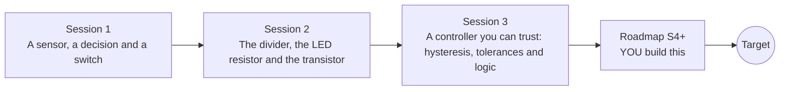

# openledcontrol

[](https://github.com/KrunalPanchal1995/openledcontrol/actions/workflows/ci.yml)   [](https://colab.research.google.com/github/KrunalPanchal1995/openledcontrol/blob/main/sessions/session-01/lesson.ipynb) [](https://krunalpanchal1995.github.io/openledcontrol/)

**Build a light-activated LED controller, from an LDR to a transistor switch, in three sessions.**

openledcontrol teaches how a night light decides: a light sensor, a voltage divider, a comparator with hysteresis, a transistor switch and simple logic, using only Python and a browser.

- **Start from zero.** Session 1 needs only the idea that a sensor feeds a decision; the Ohm's-law-style maths arrives gently in Session 2.
- **See it switch.** Every session ships a slider app that runs in the browser, with labelled graphs and a challenge.
- **Know you got it right.** Each session ends with a checkpoint that prints PASS or FAIL against hand calculations.
- **Build the missing half.** The repo stops at Session 3 on purpose; the roadmap shows the path to the Target.

[Target](#the-target) · [Who is this for](#who-is-this-for) · [Quick start](#quick-start) · [Sessions](#sessions) · [Roadmap](#roadmap) · [Contribute](#contribute) · [Explainer PDF](docs/explainer.pdf)

> **This repo is incomplete on purpose.** Sessions 1 to 3 are here and fully working. The finished Target below is a preview of what the community can build next. We show you the path, not the code. Sessions 4 and up are yours.

## The Target

One cloudy day plays out in 24 hours. The sensor voltage rises and falls with the light. Three controllers watch the same signal: a single-threshold comparator that flips on and off 14 times around dawn and dusk, a Schmitt trigger that switches exactly twice, and a Schmitt trigger whose LED fades in and out over ten minutes instead of jumping. Your goal over the coming sessions: build the middle and right-hand controllers yourself, then make them robust against real parts.


*Target: one cloudy day, three controllers (single threshold, Schmitt trigger, Schmitt with fade)*


*The end of the day: 14 flips against 2*


*Dawn close-up: the same noisy sensor signal gives chatter or a clean switch*

Try it live:

- [Math Visual Studio (open the Studio and explore curves and functions)](https://krunalpanchal1995.github.io/studio/)

How the Target was made is shown only as a path in [promo/roadmap.md](promo/roadmap.md).

## Who is this for
**secondary school to diploma / undergraduate (levels 3-5).** Topic area: Electricity, Magnetism and Electronics.

Prerequisites:

- Basic idea of voltage, current and resistance (Ohm's law: V = I R). openohm in this series covers it if you need a refresher.
- Python 3.10 or newer; if `python --version` works, you are ready. PRIMER.md explains the rest.
- No prior electronics kit, GitHub or programming experience is needed.

New to Python? Read [PRIMER.md](PRIMER.md) first (10 minutes).

## Quick start

No installation knowledge needed. You need [Git](https://git-scm.com/downloads) and [Python 3.10+](https://www.python.org/downloads/) (Windows: tick "Add Python to PATH"). On Mac and Linux type `python3` wherever this page says `python`.

```bash
git clone https://github.com/KrunalPanchal1995/openledcontrol.git
cd openledcontrol
python start.py 1
```

`start.py` creates a private environment, installs what is needed and runs Session 1 with its checkpoint. Next: `python start.py 2`, `python start.py 3`, or `python start.py test` to check everything. Only a checkpoint: `python start.py check 1`.

Four lines turn the idea of Session 1 into a result (they work as they are): Save it as `try.py` and run it with `python start.py run try.py` (this uses the private environment, where NumPy is installed):

```python
import numpy as np
lux = np.array([1.0, 10.0, 100.0, 1000.0])      # dark room ... bright room
R_ldr = 10_000 * (lux / 10) ** -0.7             # illustrative LDR curve, ohm
print(np.round(R_ldr))                          # -> [50119. 10000.  1995.   398.]
```

Every session also opens in your browser with sliders (no install): [live apps](https://krunalpanchal1995.github.io/openledcontrol/). Or use the Colab badge above for the notebook.

## Sessions

| # | Session | Model level | Time | Live app |
|---|---|---|---|---|
| 1 | [A sensor, a decision and a switch](sessions/session-01/README.md) | Level 1: conceptual interactive model | 60 min | [open](https://krunalpanchal1995.github.io/openledcontrol/session-01/) |
| 2 | [The divider, the LED resistor and the transistor](sessions/session-02/README.md) | Level 2: mathematical engineering model | 75 min | [open](https://krunalpanchal1995.github.io/openledcontrol/session-02/) |
| 3 | [A controller you can trust: hysteresis, tolerances and logic](sessions/session-03/README.md) | Level 3: simulation and validation | 90 min | [open](https://krunalpanchal1995.github.io/openledcontrol/session-03/) |

Each session follows the same six steps: A real-world problem, B concept and theory, C visual explanation, D interactive simulation, E worked example and experiment, F assessment and design challenge. Each ends with `checkpoint.py`, which prints `PASS` or `FAIL` against reference numbers. Session 3 also contains the real-world mini-project: **Add a manual override to the night light**.

## Architecture



| Folder or file | What is inside |
|---|---|
| `sessions/` | three sessions: README (A-F), `lesson.py`, notebook, live app, exercises, activity sheet, checkpoint |
| `promo/` | the Target: media, live links, and the roadmap (path only) |
| `docs/` | `explainer.tex` and the built `explainer.pdf` |
| `tests/` | runs every lesson and checkpoint headless |
| `start.py` | one command to set up and run anything |
| `QUALITY.md`, `RUBRIC.md` | the quality checklist and the scoring rubric |
| `.github/` | CI, PDF build, Pages deploy, issue and PR templates |

## Roadmap

| Milestone | What you will build | Difficulty |
|---|---|---|
| Session 4: Debounce instead of hysteresis | A controller with a single threshold plus a debounce timer, compared with the Schmitt trigger. | intermediate |
| Session 5: Fade the LED in and out | A brightness output between 0 and 1 that follows the decision gradually. | intermediate |
| Session 6: Make the trip point immune to the supply | A comparator reference that follows the supply or a stable fixed reference with a regulated supply, checked by Monte Carlo. | advanced |
| Session 7: Calibrate the LDR from measurements | A fit from six noisy readings of resistance against light, then a controller built from the fitted curve. | advanced |
| Session 8: A latching alarm with reset | A gate-level alarm with inputs A, B and RESET whose output stays on after the cause is gone. | advanced |

Full detail with a checkpoint per milestone: [promo/roadmap.md](promo/roadmap.md).

## Contribute
New to GitHub? Read [CONTRIBUTING.md](CONTRIBUTING.md); it starts from zero. Pick an issue labelled `good first issue`. Translations into Hindi, Telugu, Tamil and Malayalam are welcome.

<details>
<summary>Development</summary>

```bash
python start.py test        # runs every lesson and checkpoint
```
Lessons use `# %%` cell markers so they open as notebooks in VS Code. See [QUALITY.md](QUALITY.md) for the standard every session meets.
</details>

## License
MIT. See [LICENSE](LICENSE). Media in `promo/media` is (c) Krunal Panchal, CC BY 4.0.

## Acknowledgments
Part of the [PAN IIT OSS](https://hellofoss.tech-iitb.org/projects) open-source teaching collection, modelled on the structure of [openspline](https://github.com/openspline/openspline). Built on ideas from the Math Visual Studio at https://krunalpanchal1995.github.io/studio/.
