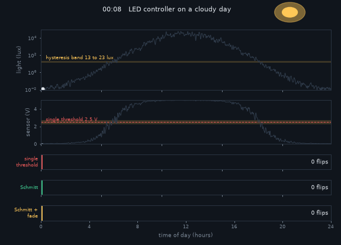
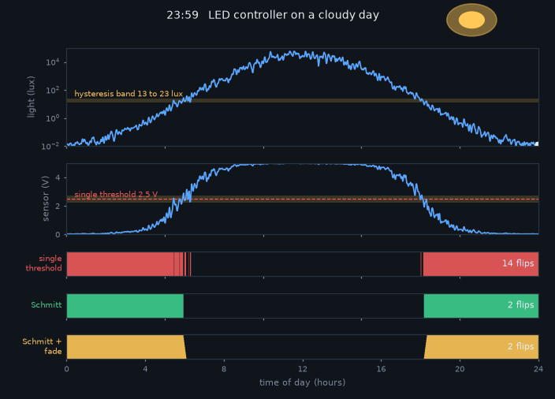
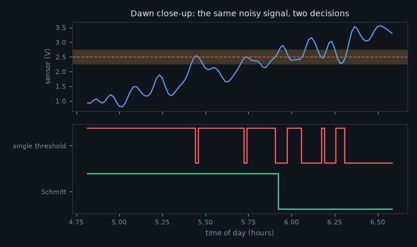

# What you are building toward

One cloudy day plays out in 24 hours. The sensor voltage rises and falls with the light. Three controllers watch the same signal: a single-threshold comparator that flips on and off 14 times around dawn and dusk, a Schmitt trigger that switches exactly twice, and a Schmitt trigger whose LED fades in and out over ten minutes instead of jumping. Your goal over the coming sessions: build the middle and right-hand controllers yourself, then make them robust against real parts.

*Target: one cloudy day, three controllers (single threshold, Schmitt trigger, Schmitt with fade)*

*The end of the day: 14 flips against 2*

*Dawn close-up: the same noisy sensor signal gives chatter or a clean switch*

These results come from a private reference build. The code is not published; the roadmap shows the path so you can build your own.

Live links:

- [Math Visual Studio (open the Studio and explore curves and functions)](https://krunalpanchal1995.github.io/studio/)
