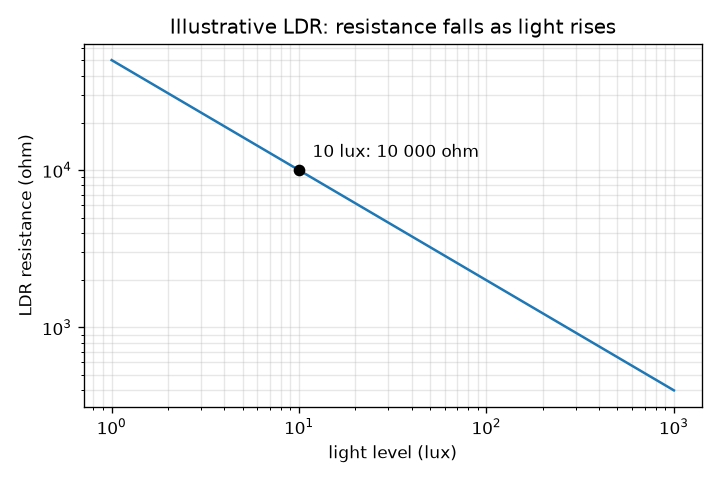
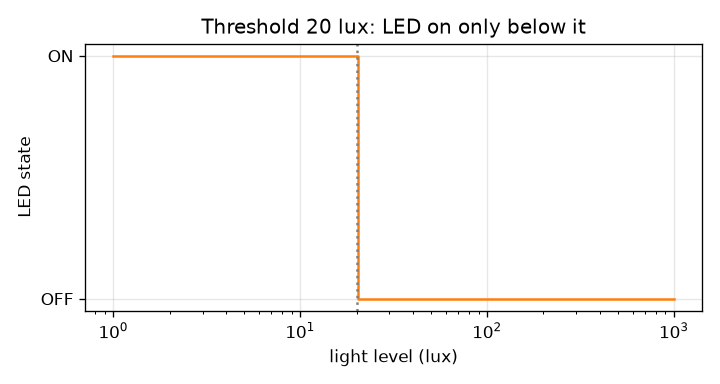

# Session 1: A sensor, a decision and a switch

*Level 1 (conceptual interactive model) · about 60 minutes · openledcontrol*

> This is a simplified educational model. It is not a validated design tool and must not be used for real structures, electrical installations, vehicles, industrial processes or medical decisions.

**Prerequisites**

- Know that electric current flows through a resistor and that a bigger resistance lets less current through.
- You have read PRIMER.md and run `python start.py 1` once.

**Learning objectives.** After this session you can:

- Explain how a light dependent resistor (LDR) senses light.
- Draw and label the block diagram of a light-activated LED controller.
- Use the illustrative LDR curve to find its resistance at a given light level.
- Decide, with a threshold, when the LED should be on, and read this from a graph.

## A. Real-world problem
A garden path light comes on by itself at dusk and goes off at dawn. Nobody touches a switch. How does a small circuit know that it is getting dark, and how does it turn a lamp on? In this session you meet the three jobs every automatic controller does: sense, decide, act. All circuits in this repo are low-voltage educational models (a few volts, a few milliamps), not designs for mains lighting.

## B. Concept and theory
A light dependent resistor (LDR) is a resistor whose resistance falls when light falls on it: large in the dark, small in bright light. Light level is measured in lux (a candle-lit room is a few lux, an office a few hundred, a sunny day tens of thousands). Real LDRs differ from part to part, so we use an assumed, illustrative curve: the resistance at 10 lux is 10 000 ohm, and each tenfold increase of light divides the resistance by 10 to the power 0.7 (about 5). A controller has four blocks in a chain: the LDR and its divider (senses), a comparator (decides: is the light below the threshold?), a transistor switch (carries the LED current) and the LED with its resistor (the lamp). In Session 1 the comparator is simply 'lux below threshold'.

| Symbol | Meaning | Unit |
|---|---|---|
| lux | light level at the sensor | lux |
| R_ldr | LDR resistance | ohm |
| R10 | assumed LDR resistance at 10 lux (10 000) | ohm |
| gamma | assumed slope of the LDR curve (0.7) | no unit |
| threshold | light level below which the LED turns on | lux |

**Assumptions**

- The LDR curve is an assumed, illustrative model, not a data sheet.
- The LDR responds instantly (real ones take tens of milliseconds or more).
- Low-voltage educational model only; never connect this idea to mains wiring.
- Light level is the same everywhere around the sensor.

$$ R_{\mathrm{ldr}}=R_{10}\left(\frac{\text{lux}}{10}\right)^{-\gamma},\qquad R_{10}=10\,000\ \Omega,\ \gamma=0.7 $$

$$ \text{LED on}\iff \text{lux}<\text{threshold} $$

## C. Visual explanation
The first figure is the illustrative LDR curve on log-log axes: a straight line sloping down, because the resistance falls by the same factor every time the light rises by a given factor. It passes through the anchor point (10 lux, 10 000 ohm). The second figure shows the LED state against light for a 20 lux threshold: a step from ON (dark side, left) to OFF (bright side, right). The app's first view is the block diagram: the four boxes light up as the decision changes.

*The illustrative LDR: a straight line on log-log axes, passing through (10 lux, 10 000 ohm).*

*A 20 lux threshold: the LED is on only on the dark side.*

## D. Interactive simulation
Run the lesson (`python start.py 1`), then open the live app: [Session 1: sense, decide, switch](https://krunalpanchal1995.github.io/openledcontrol/session-01/) (or `app.html` in this folder). Move the light slider and watch the LDR resistance in the first box and the LED at the end of the chain. Then change the threshold and see where the dashed line on the graph moves.

**Challenge.** Make the LED turn on while the room is at 25 lux or more, by choosing a higher threshold.

## E. Worked example and experiment
**Problem.** At 2 lux, what is the LDR resistance with the illustrative curve, and is the LED on with a 20 lux threshold?

1. Light divided by 10: 2 / 10 = 0.2.
2. R = 10 000 * 0.2 ^ (-0.7). Since 0.2 ^ (-0.7) = 5 ^ 0.7 = 3.085, R = 10 000 * 3.085 = 30 852 ohm.
3. Compare with the threshold: 2 lux is below 20 lux, so the room is dark enough.
4. The comparator says 'dark', the transistor closes and the LED is ON.
5. Sanity check: 2 lux is darker than the 10 lux anchor, so the resistance must be above 10 000 ohm. It is.

**Answer.** R is about 30 850 ohm and the LED is ON.

**Experiment.** Connect an LDR to a multimeter set to resistance. Read it in a bright room, with your hand shading it, and covered by a cup. You will see a large range, for example a few kilo-ohm to hundreds of kilo-ohm, and the exact numbers will not match the model: real LDRs have their own curve, depend on colour and temperature, and react slowly. The model gets the direction (resistance falls with light) right; the numbers are an assumption.

## F. Assessment and design challenge
**Question type A: Conceptual.** Why is a sensor whose resistance changes useful for a controller? Why do we also need a separate 'decision' block instead of connecting the LDR straight to the LED?

Hint

A resistance is not yet a yes/no answer, and the LED needs a definite on or off.

Step-by-step solution

A change of resistance can be turned into a voltage that follows the light (Session 2), which a circuit can measure. But the LED needs a clear on/off command at a chosen light level: the comparator turns the continuous signal into yes or no, and the transistor then supplies the LED current. Without the decision block the LED would just glow a little brighter or dimmer, and a small sensor signal could not carry the LED current.

**Question type B: Numerical.** Using R = 10 000 * (lux / 10) ^ (-0.7), find the LDR resistance at 1 lux and at 1 000 lux. By what factor do they differ? Sanity check the factor.

Hint

1 lux gives lux/10 = 0.1 and 1 000 lux gives 100.

Step-by-step solution

At 1 lux: 10 000 * 0.1 ^ (-0.7) = 10 000 * 5.012 = 50 119 ohm. At 1 000 lux: 10 000 * 100 ^ (-0.7) = 10 000 * 0.03981 = 398 ohm. Factor = 50 119 / 398 = 125.9, which equals 1 000 ^ 0.7 = 125.9 (a thousand times more light, resistance about 126 times less). Units: ohm.

**Question type C: Graph and simulation interpretation.** In the app's graph, the curve is steep on the left and nearly flat on the right. What does that say about how well an LDR distinguishes 5 lux from 15 lux compared with 405 lux from 415 lux?

Hint

Compare the change of resistance for the same change of light at the two places.

Step-by-step solution

On the left (dim light) a small change of light changes the resistance a lot, so dim light levels are easy to tell apart. On the right a change of 10 lux changes the resistance by only a few ohm, so bright light levels are hard to tell apart. That is why LDR controllers work best around dusk (tens of lux) and not for measuring bright daylight accurately.

**Question type D: Design and optimisation challenge.** Design: a path light should turn on at dusk. Compare thresholds of 5 lux and 50 lux. Which would you choose and why? Give the LDR resistance at each threshold.

Hint

Think about when each threshold is reached, energy use and safety, and compute R at both.

Step-by-step solution

R at 5 lux = 16 245 ohm; R at 50 lux = 3 241 ohm. A 50 lux threshold switches on earlier, in deep twilight, which is safer for walkers but uses more LED hours; 5 lux switches on when it is really dark, saving energy but leaving a dim period. A sensible compromise for a path is about 20 to 30 lux. Trade-off: safety and comfort against energy, and later (Session 3) against chatter near the threshold.

Score yourself with [RUBRIC.md](../../RUBRIC.md). Print the [activity sheet](activity_sheet.md) to work on paper.

## Common misconceptions
| Common misconception | What is actually true |
|---|---|
| An LDR makes light. | An LDR only senses light by changing its resistance; the LED is what makes light. |
| A bigger LDR resistance means more light. | It is the opposite: resistance falls as light rises. |
| The sensor switches the LED directly. | The sensor only changes a resistance; the decision and the switch are separate blocks. |
| The 10 000 ohm in the model is the 'real' LDR value. | It is an assumed, illustrative number. Real parts vary a lot and you must read the data sheet or measure. |

## Glossary
- **LDR**: light dependent resistor: a resistor whose resistance falls when light falls on it
- **lux**: unit of light level on a surface
- **threshold**: the light level at which the controller changes its decision
- **comparator**: a circuit that compares a signal with a threshold and gives a yes or no
- **transistor switch**: a transistor used fully on or fully off to carry a larger current under a small control signal

## Finish
1. Do the three coding tasks in [exercises.md](exercises.md).
2. Run `python start.py 1` again after your changes. It ends with the checkpoint; when it prints `PASS`, you are done. (Checkpoint only: `python start.py check 1`.)

Next: [Session 2](../session-02/README.md)
