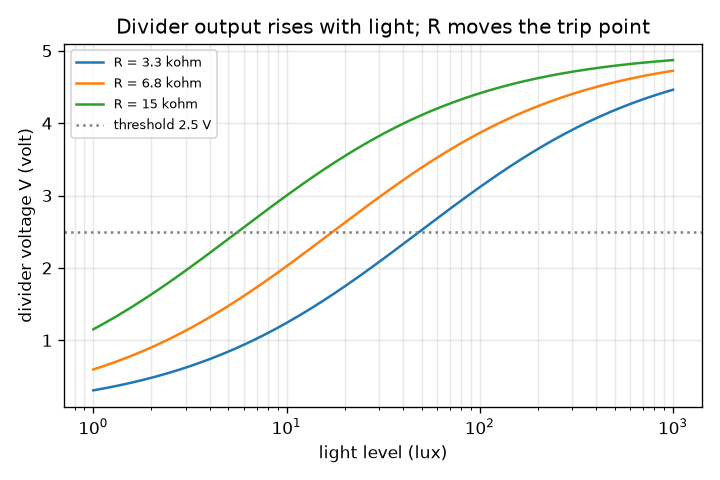
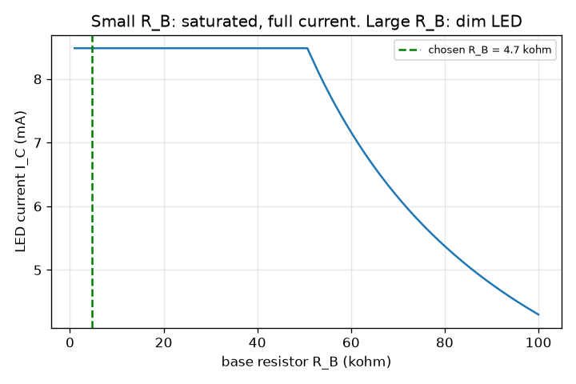

# Session 2: The divider, the LED resistor and the transistor

*Level 2 (mathematical engineering model) · about 75 minutes · openledcontrol*

> This is a simplified educational model. It is not a validated design tool and must not be used for real structures, electrical installations, vehicles, industrial processes or medical decisions.

**Prerequisites**

- Session 1: the LDR and the block diagram.
- Ohm's law, V = I R, and series resistors.

**Learning objectives.** After this session you can:

- Turn the LDR resistance into a voltage with a voltage divider.
- Choose the fixed resistor for a wanted threshold light level.
- Size the LED current-limiting resistor and the transistor base resistor (forced gain 10).
- Solve a design problem: the components of an automatic night light.

## A. Real-world problem
A comparator and a transistor cannot read an LDR's resistance directly: they need a voltage. And an LED must never be connected straight to a supply or it burns out. For a night light that comes on below 20 lux, which resistor goes with the LDR, how big is the LED resistor, and what stops the transistor from only half switching on? All values are for a low-voltage educational circuit at 5 V; 'typical' values come from typical small parts and must be checked against a real data sheet.

## B. Concept and theory
Put a fixed resistor R in series with the LDR across the supply Vcc. The voltage across R is V = Vcc R / (R + R_ldr): small in the dark (R_ldr large), large in the light. The comparator calls it dark when V falls below a threshold V_th. At the threshold light level the divider gives exactly V_th, so R_ldr = R (Vcc - V_th) / V_th; with V_th = Vcc / 2 the two resistors are equal, so R = R_ldr(threshold). An LED has a nearly fixed forward voltage Vf (about 2 V for red, typical); its resistor takes the rest: R_led = (Vcc - Vf) / I, with about 10 mA typical for an indicator LED. The comparator cannot carry 10 mA, so it drives the base of an NPN transistor: the LED path is in the collector. Real current gain is unreliable (it varies several times between parts), so for a switch we use a forced gain of about 10: I_B = I_C / 10 and R_B = (V_drive - V_BE) / I_B, with V_BE about 0.7 V (typical). Too little base current leaves the transistor half on: the LED is dim and the transistor itself dissipates I_C V_CE. Resistors come in standard values (E12 series), so we pick the nearest suitable part.

| Symbol | Meaning | Unit |
|---|---|---|
| Vcc | supply voltage (5) | V |
| R | fixed resistor in the divider | ohm |
| V | divider output voltage | V |
| V_th | comparator threshold voltage | V |
| Vf | LED forward voltage (about 2, typical) | V |
| I | LED current (about 10 mA, typical) | A |
| V_BE | base-emitter voltage (about 0.7, typical) | V |
| I_B, I_C | base and collector currents | A |
| R_led, R_B | LED resistor and base resistor | ohm |

**Assumptions**

- The LDR follows the illustrative curve R_ldr = R10 (lux/10)^(-gamma), gamma = 0.7 (assumed, typical-style model).
- The comparator input draws no current and its output swings to Vcc when 'dark'.
- Vf, V_BE, V_CE(sat) = 0.2 V and gain 100 are typical values, not exact.
- Low-voltage educational model; not a design for mains lighting.

$$ V=V_{cc}\,\frac{R}{R+R_{\mathrm{ldr}}} $$

$$ R=R_{\mathrm{ldr}}(\text{threshold})\,\frac{V_{th}}{V_{cc}-V_{th}} $$

$$ R_{\mathrm{led}}=\frac{V_{cc}-V_f}{I} $$

$$ I_B=\frac{I_C}{10},\qquad R_B=\frac{V_{\mathrm{drive}}-V_{BE}}{I_B} $$

## C. Visual explanation
The first figure plots the divider voltage against light for three fixed resistors (3.3, 6.8 and 15 kilo-ohm): each curve rises from near 0 V in the dark to near 5 V in bright light, and it crosses the 2.5 V line at a different light level: a larger R crosses at a lower light level. The second figure plots the LED current against the base resistor: flat (full current, saturated) for small R_B, then falling like 1 / R_B (dim LED) once R_B passes about 50 kilo-ohm. The chosen 4.7 kilo-ohm sits far inside the flat part, which is the point of the forced gain of 10.

*Divider voltage against light: a bigger fixed resistor trips at a lower light level.*

*LED current against base resistor: full current for small R_B, dim for large R_B.*

## D. Interactive simulation
Run the lesson (`python start.py 2`), then open the live app: [Session 2: divider, trip point and transistor](https://krunalpanchal1995.github.io/openledcontrol/session-02/) (or `app.html` in this folder). Move R and the threshold voltage and watch the trip light level in the divider graph. Then open the transistor graph and move the base resistor across the 'forced gain 10 limit' line.

**Challenge.** Make the light switch on below about 10 lux (9.5 to 10.5) with a base resistor of 5 kilo-ohm or less.

## E. Worked example and experiment
**Problem.** Design a night light for 5 V that turns on below 20 lux, using the illustrative LDR, a red LED at about 10 mA, an NPN transistor and V_th = Vcc / 2. Find R, R_led and R_B, and say what threshold you really get.

1. LDR at 20 lux: R_ldr = 10 000 * (20 / 10) ^ (-0.7) = 10 000 * 0.6156 = 6 156 ohm.
2. With V_th = 2.5 V = Vcc / 2, R = R_ldr = 6 156 ohm. E12 neighbours: 5.6 kilo-ohm (trips at 22.9 lux) and 6.8 kilo-ohm (trips at 17.3 lux). Choose 6.8 kilo-ohm, or use a 10 kilo-ohm trimmer for an adjustable threshold.
3. LED resistor: (5 - 2) / 0.010 = 300 ohm, next E12 value up: 330 ohm, so I = 3 / 330 = 9.09 mA.
4. Base current for forced gain 10: I_B = 9.09 / 10 = 0.909 mA. R_B = (5 - 0.7) / 0.000909 = 4 730 ohm, E12 value at or below: 4.7 kilo-ohm, so I_B = 0.915 mA.
5. Check: with V_CE(sat) = 0.2 V the LED gets (5 - 2 - 0.2) / 330 = 8.48 mA, so the actual forced gain is 8.48 / 0.915 = 9.3, which is under 10. The transistor is saturated and dissipates about 8.48 mA * 0.2 V = 1.7 mW.

**Answer.** R = 6.8 kilo-ohm (trips at 17.3 lux instead of exactly 20), R_led = 330 ohm (9.09 mA), R_B = 4.7 kilo-ohm (I_B = 0.915 mA, LED current 8.5 mA).

**Experiment.** On a breadboard use a 5 V supply, a real LDR, a 10 kilo-ohm trimmer in place of R, a small NPN such as a 2N3904 (or equivalent) and a red LED. Measure the divider voltage with a multimeter in room light and under a shade, and adjust the trimmer until the LED turns on at your chosen dimness. Compare the LED current (measure the voltage across the 330 ohm resistor and divide) with 8.5 mA. Differences come from your LDR curve (not the assumed one), the LED's real Vf (1.8 to 2.2 V for red), and the transistor's real V_CE(sat).

## F. Assessment and design challenge
**Question type A: Conceptual.** Why do we size the base resistor for a forced gain of 10 when the transistor's gain might be 100 or more?

Hint

Datasheet gain is a range, and gain falls with temperature and when the transistor is hard on.

Step-by-step solution

The gain varies a lot between parts and with temperature and current. If we counted on gain 100 and a part has gain 40, the transistor would not carry the full LED current: it would be only half on, so the LED would be dim and the transistor would heat. Feeding 10 times more base current than the gain 100 would need makes the switch fully on for every realistic part, at the cost of a little extra base current.

**Question type B: Numerical.** A blue LED has Vf = 3.0 V (typical) and should carry 15 mA from 5 V. Find the LED resistor (pick an E12 value at or above the result) and the actual current, then the base resistor for forced gain 10 with a 5 V drive (E12 at or below).

Hint

R_led = (5 - 3) / 0.015, and use the actual LED current to size I_B.

Step-by-step solution

R_led = 2 / 0.015 = 133 ohm, E12 value up = 150 ohm, actual current = 2 / 150 = 13.3 mA. I_B = 1.33 mA, R_B = 4.3 / 0.00133 = 3 225 ohm, E12 value down = 2.7 kilo-ohm, giving I_B = 1.59 mA. Sanity check: I_B = 1.59 mA is a little more than one tenth of 13.3 mA, so the forced gain is under 10 and the transistor is safely saturated.

**Question type C: Graph and simulation interpretation.** In the divider graph the 15 kilo-ohm curve crosses 2.5 V at a lower light level than the 3.3 kilo-ohm curve. Read the two crossing light levels, and explain why a bigger R trips at a lower light level.

Hint

Use R = R_ldr at 2.5 V and the LDR curve: where is R_ldr = 15 000 ohm and where is it 3 300 ohm?

Step-by-step solution

R = R_ldr at the trip, so 15 000 ohm gives lux = 10 * (10 000 / 15 000)^(1/0.7) = 5.6 lux and 3 300 ohm gives 48.7 lux. A bigger fixed resistor needs a bigger LDR resistance to balance it, and the LDR is only that large when it is darker. So bigger R means a darker trip point.

**Question type D: Design and optimisation challenge.** Design an automatic night light that turns on below 30 lux with V_th = 2.5 V: choose R from E12 and state the real trip level, choose R_led and R_B for a 10 mA red LED, and say how you would make the threshold adjustable.

Hint

R_ldr at 30 lux with the curve, then E12 nearest; the LED and base values are as in the worked example.

Step-by-step solution

R_ldr(30 lux) = 10 000 * 3 ^ (-0.7) = 4 635 ohm. The nearest E12 value is 4.7 kilo-ohm, which trips at 29.4 lux (very close). R_led = 330 ohm (9.09 mA) and R_B = 4.7 kilo-ohm as before. For an adjustable threshold replace R by a 10 kilo-ohm trimmer in series with a small fixed resistor: at 10 kilo-ohm it trips at 10.0 lux, and 3.3 kilo-ohm trips at 48.7 lux, so the range covers 10 to 49 lux. Assumptions: illustrative LDR curve, typical LED and transistor values; a real build needs a data sheet check and a test.

Score yourself with [RUBRIC.md](../../RUBRIC.md). Print the [activity sheet](activity_sheet.md) to work on paper.

## Common misconceptions
| Common misconception | What is actually true |
|---|---|
| The LED needs no resistor because it only takes what it needs. | An LED has almost no internal resistance once it conducts; without a resistor the current runs away and the LED burns out. |
| Bigger base current always saturates the transistor more, so use the smallest base resistor. | Beyond forced gain 10 you only waste current (and may overload the comparator); the LED current is fixed by its resistor, not by the base. |
| A transistor 'gain of 100' means I_C is always 100 times I_B. | That holds only in the active region. When saturated I_C is set by the load and I_C / I_B is smaller. |
| The divider voltage is the LDR's voltage. | In our circuit V is measured across the fixed resistor R. The LDR has the remaining Vcc - V. |

## Glossary
- **voltage divider**: two resistors in series that share a supply voltage in proportion to their resistance
- **forward voltage**: the almost constant voltage across a conducting LED
- **saturation**: the transistor fully on, with a very small voltage across it
- **forced gain**: the deliberately low ratio I_C / I_B used so the switch is fully on
- **E12 series**: standard resistor values: 1.0, 1.2, 1.5, 1.8, 2.2, 2.7, 3.3, 3.9, 4.7, 5.6, 6.8, 8.2 times a power of ten

## Finish
1. Do the three coding tasks in [exercises.md](exercises.md).
2. Run `python start.py 2` again after your changes. It ends with the checkpoint; when it prints `PASS`, you are done. (Checkpoint only: `python start.py check 2`.)

Next: [Session 3](../session-03/README.md)
