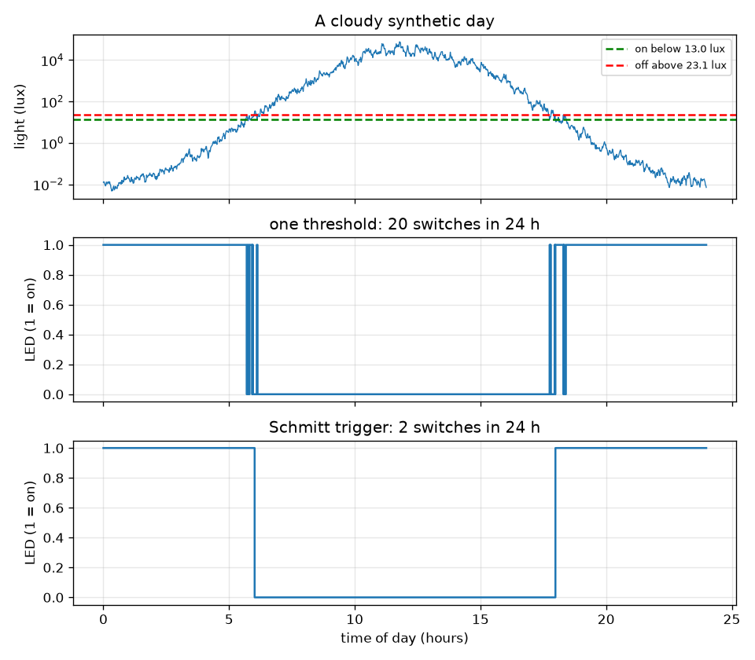
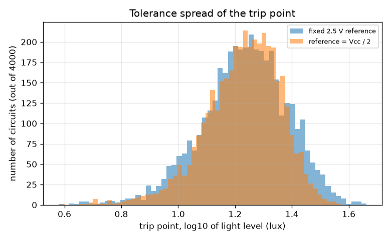

# Session 3: A controller you can trust: hysteresis, tolerances and logic

*Level 3 (simulation and validation) · about 90 minutes · openledcontrol*

> This is a simplified educational model. It is not a validated design tool and must not be used for real structures, electrical installations, vehicles, industrial processes or medical decisions.

**Prerequisites**

- Session 1: the block diagram.
- Session 2: the divider, trip point and transistor.
- Basic idea of AND, OR, NOT (explained from scratch in Section B).

**Learning objectives.** After this session you can:

- Simulate the whole controller over a day and count its on-off switches with and without hysteresis.
- Check the simulated switching against hand-calculated thresholds and analytic switching times.
- Use a Monte Carlo run to see how part tolerance and supply voltage move the trip point.
- Build a two-condition alarm with gates, test its truth table on every input, and explain two failure cases.

## A. Real-world problem
At dusk the light does not fall smoothly: clouds, trees and passing cars make it wobble, so a comparator with one threshold flips the LED on and off, on and off, whenever the noisy light crosses it. That 'chatter' annoys people and wears relays. And every real part is a little different from its label. How do we make the controller decide once, and how far can we trust its trip point? A related question appears in safety design: how do you build an alarm that fires when either of two independent safety conditions is violated? This session is a low-voltage educational simulation, not a validated design tool.

## B. Concept and theory
A Schmitt trigger is a comparator with two thresholds: the LED turns on when the sensor voltage falls below V_LO and turns off only when it rises above V_HI; in between it keeps its state (memory). With our divider, V_LO = 2.25 V and V_HI = 2.75 V correspond to light levels found from lux = 10 (R10 / R_ldr)^(1/gamma) with R_ldr = R (Vcc - V) / V. The synthetic day follows log10(lux) = 1.3 + 3.2 sin(2 pi (t - 6) / 24) with t in hours, times a seeded random cloud factor exp(sigma n), where n is smoothed noise (AR(1), coefficient 0.8). Without clouds the switching times can be solved exactly, so the simulation is validated against them. A Monte Carlo run draws many circuits with random part values and looks at the spread of the trip point. For digital logic, signals are 0 or 1. The alarm for 'condition A or condition B is violated' is OR: its truth table is 0, 1, 1, 1. De Morgan's law says A OR B equals NOT(NOT A AND NOT B), so the same alarm can be built from NOT gates and a NAND. A gate simulator evaluates a list of gates in order, and a truth table is checked on all 2^n input rows (exhaustively).

| Symbol | Meaning | Unit |
|---|---|---|
| V_LO, V_HI | Schmitt thresholds (2.25 and 2.75) | V |
| sigma | cloud strength: standard deviation of ln(lux) noise (0.35) | no unit |
| t | time of day | h |
| switches | number of LED state changes in 24 h | count |
| E | energy over the day | Wh |
| A, B | the two alarm conditions (1 = violated) | no unit |

**Assumptions**

- The light curve, the cloud noise and the LDR are synthetic and illustrative, not measurements.
- The comparator is ideal: no offset, no delay; hysteresis is exact.
- The LDR tolerance (20 percent standard deviation on R10), the resistor tolerance (5 percent) and the supply range (4.5 to 5.5 V) are assumed for illustration.
- Low-voltage educational model; alarm logic here is a teaching exercise, not a certified safety system.

$$ \log_{10}(\text{lux})=1.3+3.2\sin\!\left(\frac{2\pi (t-6)}{24}\right) $$

$$ \text{lux}(V)=10\left(\frac{R_{10}}{R\,(V_{cc}-V)/V}\right)^{1/\gamma} $$

$$ t_{\text{fall}}=6+\frac{24}{2\pi}\left(\pi-\arcsin s\right),\quad t_{\text{rise}}=6+\frac{24}{2\pi}\arcsin s,\quad s=\frac{\log_{10}(\text{lux}_{th})-1.3}{3.2} $$

$$ A\ \mathrm{OR}\ B=\overline{\overline{A}\cdot\overline{B}}\quad\text{(De Morgan)} $$

## C. Visual explanation
The first figure shows the cloudy day: light in lux on a log scale with the two threshold levels (13.0 and 23.1 lux), then the LED of a single-threshold comparator (many switches near dawn and dusk) and the LED of the Schmitt trigger (two switches: on in the evening, off in the morning). The second figure is a Monte Carlo histogram of the trip light level for a fixed 2.5 V reference and for a Vcc / 2 reference: both are wide because the LDR's own tolerance dominates, but only the fixed reference also feels the supply voltage.

*A cloudy synthetic day: light with the two threshold levels, then the LED with one threshold (20 switches) and with the Schmitt trigger (2 switches).*

*Monte Carlo spread of the trip light level (4000 circuits), fixed 2.5 V reference against Vcc / 2 reference.*

## D. Interactive simulation
Run the lesson (`python start.py 3`), then open the live app: [Session 3: one day, one threshold against a band](https://krunalpanchal1995.github.io/openledcontrol/session-03/) (or `app.html` in this folder). Raise the cloud strength and watch the single-threshold LED flip more while the band keeps it calm. Then set the band to 0 to remove the hysteresis, and change R to move the thresholds.

**Challenge.** Make the LED turn on at about 20 lux (18 to 22 lux) and turn off by 40 lux or less, by choosing R and the band.

## E. Worked example and experiment
**Problem.** For the divider with R = 6.8 kilo-ohm and Schmitt thresholds V_LO = 2.25 V and V_HI = 2.75 V, find the two light levels by hand, then the evening switch-on time and the LED on-hours of a day without clouds, and compare with the simulation.

1. At 2.25 V: R_ldr = 6 800 * (5 - 2.25) / 2.25 = 8 311 ohm, so lux = 10 * (10 000 / 8 311) ^ (1 / 0.7) = 13.0 lux. The LED turns on below 13.0 lux.
2. At 2.75 V: R_ldr = 6 800 * (5 - 2.75) / 2.75 = 5 564 ohm, so lux = 10 * (10 000 / 5 564) ^ (1.4286) = 23.1 lux. The LED turns off above 23.1 lux.
3. Evening switch-on: s = (log10(13.0) - 1.3) / 3.2 = -0.058, arcsin s = -0.058 rad, so t = 6 + (24 / 2 pi)(pi + 0.058) = 18.22 h (about 18:13).
4. Morning switch-off: s = (log10(23.1) - 1.3) / 3.2 = 0.0199, t = 6 + (24 / 2 pi)(0.0199) = 6.08 h (about 06:05).
5. On-hours = (24 - 18.22) + 6.08 = 11.86 h; the simulation (1 minute steps) gives 11.85 h. They agree to within one time step. With a cloudy day (seed 7) the single threshold switches 20 times and the Schmitt trigger 2 times.

**Answer.** The LED switches on below 13.0 lux and off above 23.1 lux; on a clean day it comes on at 18.22 h, goes off at 6.08 h and is on 11.85 h (simulation) against 11.86 h (hand calculation).

**Experiment.** Put a real LDR circuit near a window at dusk and write down (or log with a microcontroller) when your LED switches with a single threshold, then add a second resistor to make a Schmitt trigger (for example with an op-amp comparator and a positive-feedback resistor) and compare. Expect the chatter in the first case to depend on clouds and room lights, and the trip point to differ from the model by tens of percent: the real LDR curve and tolerance are not the assumed ones, as the Monte Carlo already shows.

## Real-world application and mini-project: Add a manual override to the night light
The night light must obey two buttons: FORCE_ON (hold the light on, even in daylight) and FORCE_OFF (hold it off, even at night). If both are pressed, off wins. Use the gate simulator in Session 3 (the `OVERRIDE` netlist) and `simulate_day` with the seed 7 day. Test a day where FORCE_ON is held from 12:00 to 13:00 and FORCE_OFF from 22:00 to 23:30. Then answer a power question: the whole day may use at most 0.65 Wh; with FORCE_OFF unchanged and FORCE_ON starting at 12:00, what is the longest whole-hour FORCE_ON window that fits?

**Deliverable:** A script that prints the 8-row truth table of the override controller and checks it against the rule (DARK or FORCE_ON) and not FORCE_OFF, runs the override day, prints the LED on-hours, the number of switches and the energy, tries FORCE_ON windows of 1 to 5 hours, and saves a picture of the day.

**Success looks like:** The truth table matches on all 8 rows; the override day gives 11.53 LED on-hours (baseline 12.03), 6 switches and 0.586 Wh; the longest whole-hour FORCE_ON window within 0.65 Wh is 2 hours (2 hours gives 0.633 Wh, 3 hours gives 0.680 Wh).

## F. Assessment and design challenge
**Question type A: Conceptual.** Why does hysteresis stop chatter without smoothing the light signal? And why is XOR the wrong gate for an alarm that must fire when either of two conditions is violated?

Hint

Think of the gap between the two thresholds, and what XOR does when both inputs are 1.

Step-by-step solution

With two thresholds the signal must travel the whole gap (here 2.75 - 2.25 = 0.5 V) to undo a decision, and a cloud-sized wobble is smaller than the gap, so the state does not flip back. The signal is not smoothed: it still wobbles, but the decision has memory. XOR is 1 only when exactly one input is 1, so when both conditions are violated at once (the worst case) the alarm would stay silent. OR is 1 whenever at least one input is 1.

**Question type B: Numerical.** A wider Schmitt band uses V_LO = 2.0 V and V_HI = 3.0 V with R = 6.8 kilo-ohm. Find the light levels for on and off. Compare the ratio of off-level to on-level with that of the 2.25 V and 2.75 V pair.

Hint

Use R_ldr = R (Vcc - V) / V and lux = 10 (R10 / R_ldr) ^ (1 / 0.7) for each voltage.

Step-by-step solution

At 2.0 V: R_ldr = 6 800 * 3 / 2 = 10 200 ohm, lux = 10 * (10 000 / 10 200) ^ 1.4286 = 9.7 lux. At 3.0 V: R_ldr = 6 800 * 2 / 3 = 4 533 ohm, lux = 31.0 lux. Ratio of levels: 31.0 / 9.7 = 3.2 (against 23.1 / 13.0 = 1.8 for the narrower band), so the wider band tolerates larger cloud swings but turns the light on later and off later by more.

**Question type C: Graph and simulation interpretation.** In the day-simulation figure, why do all the extra switches of the single-threshold comparator cluster near dawn and dusk and none occur at noon or midnight?

Hint

Where is the light close to the threshold level, and how big is the noise compared with the distance?

Step-by-step solution

A switch needs the noisy light to cross the threshold. At noon the light is thousands of lux, far above the 17 lux threshold, and at midnight it is a small fraction of a lux, far below it, so noise (a factor of about 1.4) cannot bridge the gap. Only around dusk and dawn, when the clean light passes through the threshold, does the noise push the signal back and forth across it. In the seed 7 day the comparator switched 20 times and the Schmitt trigger twice.

**Question type D: Design and optimisation challenge.** Design: a machine has two independent safety conditions, A (temperature too high) and B (pressure too high). The alarm must fire when either is violated. Write the truth table, choose the gate, and say how you would make a broken sensor wire fail safe. Then add a manual-override input for a maintenance person who may silence the alarm.

Hint

Four rows for two inputs; think about what a broken wire reads, and whether silencing should be allowed to hide a dangerous state.

Step-by-step solution

Truth table (A, B -> alarm): 0 0 -> 0; 0 1 -> 1; 1 0 -> 1; 1 1 -> 1, which is OR. It can also be built as NAND(NOT A, NOT B). Fail-safe: if a sensor wire breaks it usually reads 'no signal' (0). With 1 = violated that would look safe, so use active-low sensing (0 = violated, 1 = healthy): a broken wire then reads violated and raises the alarm. Override: alarm_out = alarm AND NOT silence is only acceptable for a limited time, with a visible indicator, and never for a safety condition that endangers people; in a real system this logic is certified. Trade-off: more inputs and checks give more safety but also more false alarms. This is a teaching exercise only.

Score yourself with [RUBRIC.md](../../RUBRIC.md). Print the [activity sheet](activity_sheet.md) to work on paper.

## Common misconceptions
| Common misconception | What is actually true |
|---|---|
| Hysteresis smooths or filters the noisy signal. | The signal is unchanged; hysteresis only gives the decision two thresholds and a memory. |
| A Monte Carlo run needs the exact tolerance of each part. | It samples assumed distributions many times to show the spread; the answer is only as good as those assumptions. |
| A Vcc / 2 reference fixes everything about tolerance. | It removes the supply-voltage effect, but the LDR's own tolerance still dominates the spread of the trip point. |
| XOR means 'either', so it is right for an either-or alarm. | XOR is false when both inputs are true. For 'at least one' the gate is OR. |

## Glossary
- **hysteresis**: the decision depends on the previous state: different thresholds for turning on and off
- **Schmitt trigger**: a comparator with hysteresis
- **chatter**: rapid on-off flipping when a noisy signal sits near a single threshold
- **Monte Carlo**: repeating a calculation with randomly chosen inputs to see the spread of the result
- **truth table**: a table of the output of a logic circuit for every combination of inputs
- **De Morgan's law**: NOT(A AND B) = NOT A OR NOT B, and NOT(A OR B) = NOT A AND NOT B

## Finish
1. Do the three coding tasks in [exercises.md](exercises.md).
2. Run `python start.py 3` again after your changes. It ends with the checkpoint; when it prints `PASS`, you are done. (Checkpoint only: `python start.py check 3`.)

Next: the [roadmap](../../promo/roadmap.md). Session 4 is yours to build.
